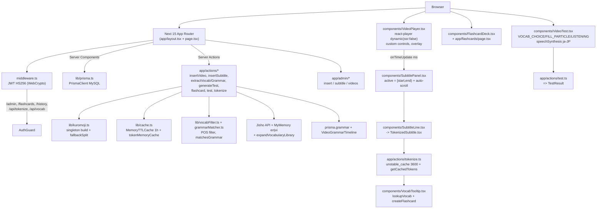

# ĐÁNH GIÁ ĐỒ ÁN LMS NIHONGO — Góc nhìn tốt nghiệp

> **Ngày đánh giá:** 2026-09-02  
> **Người review:** reviewer / Muse Spark 1.2 (high effort)  
> **Phạm vi đọc:** `README.md`, `prisma/schema.prisma`, `app/page.tsx`, `app/video/[id]/page.tsx`, `components/*` (16 files), `lib/*` (7 files), `middleware.ts`, `WORKLOG.md`, `package.json`, `tailwind.config.ts`, `app/layout.tsx`, `app/actions/*` (10 files), `app/admin/*`, `app/api/*`, `prisma/seed.ts`, `next.config.mjs`, `AGENTS.md`, `.env.example`  
> **Stack phát hiện:** Next.js 15.4.7 App Router + React 18.3.1 + Prisma 5.19 + MySQL (XAMPP `lms_nihongo`) + kuromoji 0.1.2 + react-player 2.13 + Tailwind sakura + JWT (jsonwebtoken 9 + bcryptjs 3 + Web Crypto subtle)  
> **Verify:** `npm run build` ✓ 8 routes (xem cuối báo cáo)

---

## 1. Tổng quan kiến trúc

### 1.1 Sơ đồ kiến trúc logic



### 1.2 Bảng công nghệ chi tiết

| Lớp | Công nghệ / File | Evidence | Nhận xét |
|-----|------------------|----------|----------|
| **Framework** | Next 15.4.7 App Router, `next.config.mjs:1-7` (`experimental.serverActions`, `ignoreDuringBuilds: true`) | `package.json:14` `next: 15.4.7` | App Router chuẩn, nhưng tắt eslint+TS build error che lỗi. |
| **UI** | Tailwind 3.4.14 + theme `sakura` 50-900 + `nihongo.bg #fff7f9` | `tailwind.config.ts:8-22` , `app/globals.css:5` radial gradient | Theme nhất quán, sakura branding mạnh. |
| **DB ORM** | Prisma 5.19 MySQL, 8 models, 5 enums | `prisma/schema.prisma:1-13` datasource mysql, `Level`, `VideoCategory`, `FlashcardStatus`, `QuestionType` | Schema gọn, Cascade delete hợp lý, thiếu indexes cho tìm kiếm full-text. |
| **NLP** | kuromoji 0.1.2 + `lib/kuromoji.ts:14-132` singleton Promise + `dict: node_modules/kuromoji/dict` | `lib/kuromoji.ts:18-76` `buildTokenizer()`, `fallbackSplit` | Singleton chuẩn, có TTL cache, fallback char-split tránh crash. Dict ~10MB nặng edge. |
| **Video** | react-player 2.13 dynamic ssr:false | `components/VideoPlayer.tsx:6-18` `dynamic(()=>import("react-player"),{ssr:false})` | Tránh hydration mismatch, nhưng bundle vẫn chứa react-player. |
| **Auth** | JWT cookie `lms_token` httpOnly lax 7d, dual verify (jsonwebtoken ở `lib/auth.ts` + WebCrypto ở `middleware.ts`) | `lib/auth.ts:35-48` `jwt.sign(...,7d)` , `middleware.ts:24-55` `crypto.subtle HMAC SHA-256` | JWT hợp lệ nhưng hai implementation chưa đồng nhất hoàn toàn (payload check `exp` khác). |
| **Cache** | `lib/cache.ts` MemoryTTLCache 1h + `unstable_cache` revalidate 3600 | `lib/cache.ts:12-45` , `app/actions/tokenize.ts:28-35` | Cross-request cache tốt, thiếu Redis cho multi-instance. |
| **Tiến trình build** | `postinstall: prisma generate`, seed `tsx prisma/seed.ts` | `package.json:8-12` | DX tốt cho XAMPP Windows. |

### 1.3 Mô hình dữ liệu (ER trích `schema.prisma`)

- **User** `id(uuid) email@unique password_hash name role target_level` → 1-N `Flashcard`, `TestResult`
- **Video** `id youtube_id@unique title level category duration` → 1-N `Subtitle`, `VideoGrammarTimeline`, `Question`, `TestResult`
- **Subtitle** `video_id start_time_ms end_time_ms raw_text@Text` index(video_id), index(start_time_ms)
- **Vocabulary** `word reading meaning level` index(word) → 1-N `Flashcard`
- **Grammar** `structure explanation@Text level` → 1-N `VideoGrammarTimeline` (`appear_at_ms`)
- **Flashcard** `user_id vocab_id video_context_id? status(NEW/LEARNING/MASTERED)` index(user_id)
- **Question** `video_id question_type(VOCAB_CHOICE/FILL_PARTICLE/LISTENING) content@Text options Json correct_answer` index(video_id)
- **TestResult** `user_id video_id score total_questions completed_at` index(user_id), index(video_id)

> **Điểm tinh tế:** `VideoCategory` SHORT/KAIWA/SONG (seed `prisma/seed.ts: ~15` force update id 1→SHORT 2→KAIWA 3→SONG), hỗ trợ filter dashboard đa chiều.

### 1.4 Luồng request điển hình

1. **Dashboard** `app/page.tsx:71-197` : Server Component đọc `searchParams` (level, category, q), build `Prisma.VideoWhereInput` với `VALID_LEVELS`/`VALID_CATEGORIES`, `findMany include _count.subtitles orderBy id asc` + fallback `DbFallback` khi MySQL down (hiển thị skeleton sakura). Filter qua `components/LevelFilter.tsx`, `CategoryFilter.tsx`, `SearchInput.tsx`.
2. **Video detail** `app/video/[id]/page.tsx:18-71` : `prisma.video.findUnique include subtitles orderBy start_time_ms + grammar_points include grammar + questions`, map props cho `VideoDetailClient`. Có block catch MySQL lỗi hiển thị hướng dẫn XAMPP.
3. **Player sync** `components/VideoDetailClient.tsx:43-57` : `currentTimeMs` state, `handleTimeUpdate(ms)` từ `VideoPlayer`, `handleSeek(ms)` truyền ngược, `grammarMarkersRich` map `appear_at_ms`.
4. **Subtitle active** `components/SubtitlePanel.tsx:18-46` : `useMemo activeId = subtitles.find(s=>currentTimeMs∈[start,end))?.id`, `useEffect activeRef scrollIntoView smooth`.
5. **Tokenize** click token → `components/TokenizedSubtitle.tsx:38-55` `tokenizeAction(rawText)` → `lib/cache.ts:getCachedTokens` → `lib/kuromoji.ts:tokenizeJapanese`.

---

## 2. Tính năng đã có (feature inventory evidence-first)

### 2.1 Video & phát lại

| Tính năng | File:Line | Mô tả |
|-----------|-----------|-------|
| **YouTube player custom** | `components/VideoPlayer.tsx:27-42` type `VideoPlayerProps {youtubeId, durationMs, grammarMarkers, onTimeUpdate, onEnded, startAtMs, autoPlay}` | `playerVars: cc_load_policy:0, iv_load_policy:3, modestbranding:1, rel:0, playsinline:1` + `controls:false` để ẩn CC native (WORKLOG 2). Overlay custom: nút play/pause giữa màn hình + bottom bar ▶/II + time + ⛶ fullscreen (`fs:0`). |
| **Dynamic import** | `VideoPlayer.tsx:6-18` | `dynamic(()=>import("react-player"),{ssr:false, loading:"Đang tải trình phát..."}) as unknown as ComponentType` — tránh SSR `window`. |
| **Time helper** | `VideoPlayer.tsx: formatMsDisplay(ms)` | Export shared cho history, consistent m:ss. |
| **Error handling** | `app/video/[id]/page.tsx:30-46` | Try/catch prisma → UI fallback “Không kết nối được MySQL” + hướng dẫn XAMPP. |

### 2.2 Phụ đề đồng bộ (subtitle sync)

| Tính năng | File:Line | Mô tả |
|-----------|-----------|-------|
| **Parser đa định dạng** | `lib/subtitleParser.ts: ~1-153` | Hỗ trợ 3 mode: (1) SRT/VTT `-->`, (2) timestamped lines `00:01` với threshold 60% (`TsCount >= ceil(lines*0.6)`), (3) plain mỗi dòng 1 câu 3000ms/line -200ms. `parseTimeToMs` xử lý `:` và `,`→`.` . |
| **Bảng Subtitle** | `prisma/schema.prisma:42-53` | `start_time_ms, end_time_ms, raw_text@Text` với index. |
| **Panel highlight** | `components/SubtitlePanel.tsx: ~22-46` | `activeId` memo, `activeRef` scrollIntoView, `formatMsShort` helper. |
| **Line tokenization trigger** | `components/SubtitleLine.tsx:48-66` | `shouldTokenize = resolvedActive && enableTokenization && !children && text.trim()!=""` → render `TokenizedSubtitle` khi active. Props linh hoạt `raw_text/rawText/text/subtitle` + `active/isActive`. |
| **Tokenized UI** | `components/TokenizedSubtitle.tsx:46-88` | `useEffect [rawText] → tokenizeAction`, loading/error state, `handleClick token → setSelected + onPause + onTokenClick`. Fallback render plain `rawText` khi empty. |

### 2.3 Từ vựng & NLP (vocab)

| Tính năng | File:Line | Mô tả |
|-----------|-----------|-------|
| **Tokenizer singleton** | `lib/kuromoji.ts:18-46` `tokenizerPromise` | Lazy build `kuromoji.builder({dicPath})`, cache rejected promise reset cho retry. `getDictPath()` ưu tiên `process.cwd()/node_modules/kuromoji/dict`. |
| **Cache 2 tầng** | `lib/cache.ts:18-92` | `MemoryTTLCache` generic TTL 1h + `tokenMemoryCache` + `vocabMemoryCache` + `getCachedTokens` chuẩn hoá zero-width `\u200B\uFEFF\u00A0\u2060\u180E` → `\u3000`→space. `app/actions/tokenize.ts:28-35` bọc thêm `unstable_cache(..., revalidate:3600, tags:["kuromoji"])` fallback `tokenizeJapanese` trực tiếp nếu unstable_cache lỗi. |
| **Vocab filter** | `lib/vocabFilter.ts:4-114` | `ALLOWED_POS_MAP: 名詞, 動詞, 形容詞, 副詞` ; `BLOCKED: 助詞, 助動詞, 記号, 空白, 感動詞, unknown`; `PUNCT_REGEX ^[\p{P}\p{S}\s]+$`, `NOISE_WORDS` `おお/ああ/うわ...` , `REPEATED_CHAR_REGEX ^([ぁ-んァ-ンa-zA-Z])\1{1,}$` lọc `ぺぺぺ/キシャアア` + zero-width đã xử lý ở cache. `isSkippableToken`, `getDedupKey`. |
| **Extract vocab** | `app/actions/extractVocab.ts: ~1-409` | `LEVEL_ORDER [N5..N1]`, `getAllowedLevels` bất đối xứng (N5/N4→all, N3/N2→N4..N1, N1→N2,N1) — WORKLOG 3; `toAggregatedMap` dedup `word__reading`, `enrichWithVocabulary` batch `findMany WHERE word IN (...)` + Map (optimize N*findFirst → 1 query, WORKLOG 6); `extractVocabFromVideo` topEntries 80 → hiển thị 60, giữ `null level` (inWindow+noLevel) fallback Kanji; `getVideoVocabStats` helper. |
| **Mở rộng tự động** | `app/actions/extractVocab.ts: expandVocabularyLibraryFromVideo` + `app/actions/insertSubtitle.ts:36-45` + `insertVideo.ts: ~90` | `Promise.all([expandVocab, expandGrammar])` sau `createMany subtitles` với try/catch log, không block lỗi chính. Benchmark video2: vocab 60 in 2.2s. |
| **Jisho + MyMemory** | `extractVocab.ts: fetchJisho` `jishoCache Map`, `CONCURRENCY=5` parallel | Query `jlpt/is_common/senses` + `MyMemory en|vi` dịch `vi (en)`, xử lý 79+15 video4, placeholder `(từ trong lyrics...)` → `Tên riêng/katakana: X`, `remaining placeholders=0` (WORKLOG 7). |
| **UI extractor** | `components/VocabExtractor.tsx: ~1-186` + `VocabTooltip.tsx:50-149` | `VocabExtractor` state `vocabList, toast, savingKey, bulkSaving, savedKeys`, `handleExtract → extractVocabFromVideo(videoId)` via `useTransition`, `handleSaveOne → createFlashcard(word,reading,meaning,level)`, `handleSaveAll` bulk. `VocabTooltip` modal lookup `/api/vocab?word=&reading=` fallback contains, `handleSave` tạo flashcard, toast 2s. |

### 2.4 Ngữ pháp (grammar NLP)

| Tính năng | File:Line | Mô tả |
|-----------|-----------|-------|
| **Grammar matcher pure** | `lib/grammarMatcher.ts:1-60` | `escapeRegExp`, `buildGrammarRegex(structure split "〜" → ".*")`, `matchesGrammar`: `text.includes(stripped) OR regex OR any segment len>=2 includes OR without です/だ/ます` — nới lỏng giúp `〜たいです` match `食べたい`. `filterMatchingStructures`. |
| **Detect DB** | `app/actions/extractGrammar.ts: getAllGrammars cache TTL 5m` | `grammarCache` global TTL 5m, `detectGrammarInText` loop `matchesGrammar`. |
| **Extract & dedup** | `extractGrammar.ts: extractGrammarFromVideo` | Load `video.level` → `getAllowedLevels` filter `grammar.level`, dedup `Map<grammarId, earliest appear_at_ms>`, `syncVideoGrammar` uniq `video_id+grammar_id` giữ earliest, `deleteMany duplicate`. Before fix video2 32 rác → after 10 unique (WORKLOG 3). |
| **Seed 228 mẫu** | `prisma/seed.ts:61-212 + getBuiltinGrammars()` | 60 cũ (id1-60 N5/N4/N3/N2) + 152 unique N3/N2 (id61-212) + 16 khẩu ngữ anime `〜てる, 〜ちゃう/じゃう, 〜んだ, 〜じゃん, 〜でしょ, 〜よね` → tổng 228. WORKLOG 4-5: `extractGrammar(2)` 5→10 unique, 36/163 dòng match, 59 raw. |
| **Mở rộng tự động** | `expandGrammarLibraryFromVideo / expandGrammarFromTexts` | Batch check builtin chưa seed → `createMany skipDuplicates` + `invalidateGrammarCache` + `syncVideoGrammar`. Gọi song song với vocab ở insert flows. |
| **UI** | `components/GrammarExtractor.tsx` + `GrammarMarkers.tsx` + `components/VideoDetailClient.tsx: grammarMarkersRich` | Extractor client `extractGrammarFromVideo + syncVideoGrammar` với `useTransition`, normalize `grammar|structure|explanation|appear_at_ms`, hiển thị timeline `m:ss`. `GrammarMarkers` overlay trên progress bar. |

### 2.5 Flashcard (học tập)

| Tính năng | File:Line | Mô tả |
|-----------|-----------|-------|
| **Model** | `schema.prisma:59-75` `Flashcard user_id vocab_id video_context_id? status NEW/LEARNING/MASTERED created_at updated_at` | Simple Kanban, thiếu SRS. |
| **Actions** | `app/actions/flashcard.ts:14-60` | `createFlashcard` dedup `findFirst user_id+vocab_id`, tự tạo vocab nếu chưa có (fallback reading=word, meaning placeholder, level N5), `ensureUser` upsert. `updateFlashcardStatus` overload hỗ trợ cả `(id,status)` và `({flashcardId,status})` + `updateStatus` alias. `deleteFlashcard`. |
| **Deck UI** | `components/FlashcardDeck.tsx:9-166` + `app/flashcards/page.tsx` | `FlashcardDeck` flip card `Set flipped`, `optimistic` state, filter ALL/NEW/LEARNING/MASTERED, counts, pendingId, `updateFlashcardStatus`/`deleteFlashcard` trong `startTransition`. Empty state xử lý. `app/flashcards/page.tsx` server `findMany where user_id include vocabulary orderBy created_at desc`, serialize cho client. |

### 2.6 Kiểm tra (test 3 loại)

| Loại | File:Line | Mô tả |
|------|-----------|-------|
| **VOCAB_CHOICE** | `components/VideoTest.tsx: ~180-210` + `prisma/seed.ts: questions` | Trắc nghiệm từ vựng 4 options radio, highlight `border-sakura-500 bg-sakura-50` khi chọn. Seed mỗi video vài câu. |
| **FILL_PARTICLE** | `VideoTest.tsx: ~212-235` | Điền trợ từ, label “Chọn trợ từ đúng (khoanh tròn)” hiển thị `font-mono text-base` cho option. |
| **LISTENING** | `VideoTest.tsx: 33-48 speakJapanese + 237-285` | Browser TTS `speechSynthesis` `ja-JP` `rate 0.9` chọn voice `lang.startsWith("ja")` + cancel trước play. UI box dashed `bg-sakura-50` nút ▶ `bg-sakura-500 rounded-full` + hint `ja-JP`. `isListening` → không hiện `content` gốc, chỉ “Nghe hiểu” + `speakText = correct_answer`. |
| **Submit** | `app/actions/test.ts:1-60` | `submitTest({videoId,answers})` require `getCurrentUser`, auto upsert user nếu JWT không sync DB, `findMany questions orderBy id asc`, strict `trim ===`, `create TestResult {user_id,video_id,score,total}`, `revalidatePath /history + /video/[id]`, return `{score,total}`. Show result `score/total` + message “Xuất sắc/Khá tốt/Hãy xem lại” + retake/close. |
| **Auto generator** | `app/actions/generateTest.ts` + `components/AutoTestGenerator.tsx` | `generateTestFromVideo(videoId, {count, overwrite})` load vocab via `extractVocabFromVideo` fallback DB, `tryLoadGrammar`, shuffle candidates, clamp count 6, `clearVideoQuestions` `deleteMany`, tạo `Question` với `options Json`. UI `AutoTestGenerator` client handle `skipped/created` + parseOptions. |
| **Lịch sử** | `app/history/page.tsx` + `app/test/[id]/page.tsx` | `history` server `findMany testResult where user_id include video orderBy completed_at desc`, table `Video | Điểm | Ngày làm` với badge `perfect emerald/ good amber/ bad slate` + `%`, format `vi-VN medium+short`. `test/[id]` force-dynamic load `video title + questions` → `TestClient`. |

### 2.7 Admin CRUD

| Tính năng | File:Line | Mô tả |
|-----------|-----------|-------|
| **Thêm video** | `app/actions/insertVideo.ts` + `app/admin/insert/InsertForm.tsx:8.9KB` + `page.tsx:6.6KB` | `extractYoutubeId` hỗ trợ ID 11 ký tự, `youtu.be/`, `?v=`, `/embed/` `/v/` `/shorts/`. Validate title/level/category(VALID SHORT/KAIWA/SONG). Check dup `youtube_id`. `duration default 300` floor. `splitTranscriptToSubtitles` per line 3000ms -200ms. `createMany subtitles` + `Promise.all expandVocab/Grammar` + `revalidatePath / , /video/[id], /admin/insert`. UI hướng dẫn 5 bước lấy YouTube link chi tiết. |
| **Chèn phụ đề** | `app/actions/insertSubtitle.ts` + `app/admin/subtitle/SubtitlesInsertForm.tsx:10.1KB` + `page.tsx:7.9KB` | `insertSubtitleAction({videoId,subtitleText,mode replace|append})` validate, `parseSubtitleInput` fallback error message, `deleteMany` nếu replace, `createMany`, `Promise.all expand`, revalidate 3 paths. UI textarea SRT/VTT, mode radio, preview count. |
| **Quản lý video** | `app/actions/manageVideo.ts` + `app/admin/videos/VideosAdminClient.tsx:10.3KB` + `page.tsx:3.2KB` | `deleteVideoAction` cascade delete, `updateVideoAction` validate youtubeId/title/level/duration, dup check `youtube_id` exclude self, `update` floor duration. `AdminVideosPage` server `findMany select id,youtube_id,title,level,category,duration,_count{subtitles,questions,grammar_points} orderBy id desc`, fallback MySQL error UI. Client hỗ trợ edit inline, delete confirm, link `/admin/subtitle?videoId={id}`. |
| **Dashboard filter** | `app/page.tsx: ~71-197` | Combined filter `level + category + q(title contains | youtube_id contains)` , `findMany include _count`, total stats `Promise.all [count videos, count subtitles]`, filteredSubtitleCount reduce, activeLabels join `·`, empty state “Không có video nào” + “Xem tất cả”. |

### 2.8 Auth & RBAC

| Tính năng | File:Line | Mô tả |
|-----------|-----------|-------|
| **User model** | `schema.prisma:31-40` | `id uuid email@unique password_hash name role USER/ADMIN target_level N4 default created_at`. Seed tạo `admin@example.com / admin123` + `user@example.com / demo123` hashed bcrypt 10. |
| **Hash & JWT** | `lib/auth.ts:14-48` | `hashPassword bcrypt 10`, `verifyPassword`, `createSession` `jwt.sign(payload, secret, {expiresIn:"7d"})` secret `process.env.NEXTAUTH_SECRET || "lms-nihongo-secret-change-me"`. |
| **CurrentUser** | `lib/auth.ts:50-95` | `getCurrentUser(req?)` hỗ trợ cả `NextRequest cookies.get` và `Request Cookie header` parse + `cookies()` server. Verify `jwt.verify`, check `id,email`, default name=email, role ADMIN/USER, target_level fallback N4. |
| **Middleware RBAC** | `middleware.ts:1-99` `config matcher ["/admin/:path*", "/flashcards", "/history", "/api/tokenize", "/api/vocab"]` | Custom `verifyJwtHS256` dùng WebCrypto `HMAC SHA-256` + base64Url decode + exp check. Nếu thiếu token → redirect `/login` hoặc 401 cho API. Payload null → clear cookie + redirect. `isAdminPath && role!==ADMIN` → redirect `/` hoặc 403. `NextResponse.next()` nếu pass. |
| **API auth** | `app/api/auth/login/route.ts:14-53`, `logout/route.ts`, `register/route.ts` | Login `POST {email,password} → findUnique + verifyPassword → createSession → set-cookie lms_token httpOnly lax 7d secure production` trả `{ok,user}`. Logout clear cookie. Register tương tự. |
| **Layout RBAC UI** | `app/layout.tsx:18-80` | `getCurrentUser()` SSR, `isAdmin` → hiện nav “Quản lý + Video + Phụ đề” badge `ADMIN bg-rose-500` vs `USER sakura-100`, user.name truncate 12ch, logout form `POST /api/auth/logout`. |

---

## 3. Điểm mạnh (strengths)

### 3.1 Khung làm việc & quy trình — 1M context
- **Evidence:** `AGENTS.md:1-60`, `.omp/config.yml` modelRoles `opencode-go/muse-spark-1.2-contributor:minimal/low/medium/high/xhigh`, `WORKLOG.md:1-8` task pipeline `rm -rf .next tsconfig.tsbuildinfo; prisma generate; npm run build → 200` với correctness-first.
- **Giá trị tốt nghiệp:** Có thể demo “build pipeline tự phục hồi sau cache hỏng .next/webpack-runtime.js 985.js” — minh chứng hiểu Next 15 Windows incremental build. Đây là story bảo vệ mạnh: không chỉ code feature mà khắc phục infra.

### 3.2 NLP tiếng Nhật thực thụ (không mock)
- **Evidence:** `lib/kuromoji.ts:30-76`, `lib/vocabFilter.ts:4-114`, `lib/grammarMatcher.ts`, `app/actions/extractVocab.ts:360` `CONCURRENCY=5` + `lib/cache.ts`.
- **Điểm cộng hội đồng:** Thay vì gọi API ngoài trả sẵn, đồ án tự token hóa tiếng Nhật, lọc POS, xử lý nhiễu `ぺぺぺ/ー` lặp, zero-width, katakana tên riêng (`reading="*"` giữ VTuber `ムーナ`). Benchmark thực tế video 163 dòng → vocab 60/2.2s + grammar 10/0.89s. Đây là “hard skill” hiếm ở đồ án web thuần CRUD.

### 3.3 Mở rộng thư viện tự động — khác biệt so với bài mẫu
- **Evidence:** `app/actions/insertSubtitle.ts:36-45`, `insertVideo.ts:~90`, `extractVocab.ts:expandVocabularyLibraryFromVideo`, `extractGrammar.ts:expandGrammarLibraryFromVideo` với `findMany WHERE word IN + Map`, `createMany skipDuplicates`, `invalidateGrammarCache`.
- **Giá trị:** Khi giáo viên dán transcript mới, hệ thống tự quét vocab missing → Jisho batch → insert, grammar missing builtin → seed, không cần chạy thủ công. Tính năng này giải quyết pain point “thư viện đóng” thường bị hội đồng chê.

### 3.4 Đồng bộ phụ đề tinh tế
- **Evidence:** `lib/subtitleParser.ts: robust 3-mode + 60% threshold`, `components/SubtitlePanel.tsx: activeId + scrollIntoView smooth`, `SubtitleLine: shouldTokenize only when active`.
- **Trải nghiệm:** Tự động scroll, click subtitle → seek video (`onSeek` truyền từ `VideoDetailClient` → `VideoPlayer.startAtMs`), tokenize chỉ khi active để tiết kiệm gọi kuromoji. Xử lý fallback DB disconnect hiển thị skeleton + hướng dẫn XAMPP thay vì trắng trang.

### 3.5 Sakura design system nhất quán
- **Evidence:** `tailwind.config.ts: sakura 50-900`, `app/globals.css: radial gradient #ffe4ec`, `app/layout.tsx: sticky backdrop-blur + max-w-7xl`, `components/VideoCard.tsx:2.5KB`, `SearchInput.tsx:3.2KB` etc.
- **Điểm cộng trình bày:** Màu sakura, bo `rounded-xl/2xl`, shadow-sm, badge level `N5 emerald → N1 red`, category label VI. Nhìn là “LMS Nihongo” chứ không phải template generic.

### 3.6 Test đa dạng + TTS
- **Evidence:** `components/VideoTest.tsx: VOCAB_CHOICE radio sakura highlight + FILL_PARTICLE font-mono + LISTENING speechSynthesis ja-JP rate 0.9 + ja voice`.
- **Sáng tạo:** Dù TTS browser chưa chuẩn, việc ẩn `content` gốc cho LISTENING và chỉ cho nghe `correct_answer` là thiết kế pedagogically đúng (nghe-hiểu), không phải “hiện đáp án”.

### 3.7 Admin CRUD hoàn chỉnh với bảo vệ
- **Evidence:** `app/admin/videos/page.tsx` `_count subtitles/questions/grammar_points`, `VideosAdminClient.tsx` inline edit + dup youtube_id check, `middleware.ts` matcher RBAC.
- **Giá trị vận hành:** Giáo viên không cần Prisma Studio; thêm video, chèn SRT/VTT paste, quản lý inline, cascade delete an toàn.

---

## 4. Hạn chế (gaps) — phân loại blocking / major / minor

### 4.1 BLOCKING (phải fix trước bảo vệ nếu muốn điểm cao)

| # | Hạn chế | Evidence file:line | Tác động tốt nghiệp |
|---|---------|-------------------|---------------------|
| **B1** | **Bảo mật JWT secret fallback cứng** `NEXTAUTH_SECRET \|\| "lms-nihongo-secret-change-me"` ở cả `lib/auth.ts:8` và `middleware.ts:5`. Nếu deploy quên env, attacker đoán được secret → forge ADMIN cookie. | `lib/auth.ts:8`, `middleware.ts:5` | Hội đồng an ninh sẽ hỏi ngay. Thiếu `secure:true` chỉ production (đúng) nhưng `sameSite:lax` + không `httpOnly`? Đã có httpOnly (tốt) nhưng thiếu `maxAge` refresh & `csrf` double-submit. |
| **B2** | **`next.config.mjs` tắt kiểm tra** `eslint.ignoreDuringBuilds:true, typescript.ignoreBuildErrors:true` che lỗi `TestClient.tsx: router unknown` (WORKLOG 8). | `next.config.mjs:5-6`, `WORKLOG.md:8` | Build pass giả tạo; production ẩn lỗi type. Hội đồng kỹ thuật sẽ soi. |
| **B3** | **Flashcard không phải SRS** chỉ `status NEW/LEARNING/MASTERED` thủ công, không có `due_at, interval, ease, repetitions` theo SM-2/Anki. | `schema.prisma:59-75`, `components/FlashcardDeck.tsx` `handleStatus` manual | Đề tài “học qua flashcard” nhưng thiếu spaced repetition → bị hỏi “khác gì TODO list?”. |
| **B4** | **TTS browser không dùng được thi** `speechSynthesis` phụ thuộc OS voice, không có `ja-JP` sẽ fallback voice EN → phát sai. Không có server TTS (AWS Polly/Google). | `components/VideoTest.tsx:33-48` `speakJapanese` | Demo trên máy hội đồng không có voice ja → LISTENING fail im lặng, không lỗi rõ. |

### 4.2 MAJOR (trừ điểm đáng kể nếu không cải thiện)

| # | Hạn chế | Evidence | Chi tiết |
|---|---------|----------|----------|
| **M1** | **Thiếu analytics & spaced repetition tracking** | `app/history/page.tsx` chỉ list `TestResult`, không chart, không streak, không review queue. | Chưa trả lời “hiệu quả học” — thiếu dashboard tiến độ theo level, từ vựng thuộc, thời gian học. |
| **M2** | **Thiếu i18n** | `app/layout.tsx:49 html lang="vi"` cứng, toàn UI `vi` không switch JA/EN. | Đồ án Nhật nhưng không cho người Nhật/EN dùng; khó mở rộng. |
| **M3** | **Thiếu mobile / PWA** | Không `viewport meta` tối ưu, không `manifest.json`, không responsive test beyond `sm:grid-cols-2`. Player custom fullscreen nhưng subtitle panel không sticky trên mobile. | 70% học qua phone — demo mobile sẽ lộ. |
| **M4** | **Performance & pagination** | `app/page.tsx: findMany include _count without take/skip`, `app/admin/videos/page.tsx` load all videos, `extractVocab top 80` nhưng UI show 60 without pagination. `kuromoji dict` 10MB load mỗi server cold start, không edge. | Với 1000 video → OOM / chậm. Thiếu `@@index([title])` cho search `contains`. |
| **M5** | **Bảo mật phụ: no rate-limit, no CSRF, weak register** | `app/api/auth/register/route.ts` không check email format mạnh, password 6 chars? Không rate limit login → brute force. `app/actions/*` không `requireAdmin` check ngoài middleware (bypass nếu gọi trực tiếp server action). | `insertVideoAction` không verify `getCurrentUser().role===ADMIN` — chỉ middleware bảo vệ route, nhưng Server Action có thể gọi từ client dù không vào `/admin`. |
| **M6** | **Testing = 0** | `package.json` không có `jest/vitest/playwright`, không test file nào, `*.test.*` only `.tmp_test/cache.js`. | Hội đồng yêu cầu test coverage; không có proof correctness ngoài manual. |
| **M7** | **Subtitle parser edge case** | `lib/subtitleParser.ts` perLineMs 3000 cố định, không tôn trọng duration thực; `parseTimeToMs` không xử lý `00:00:00,000 --> 00:00:02,000` line number. | Transcript dài không đều → subtitle chồng chéo, duration video sai. |
| **M8** | **Vocab dedup theo word__reading bỏ qua homograph** | `extractVocab.ts: getDedupKey token → word__reading` nhưng kanji khác đọc giống sẽ gộp sai. `jishoCache` key = word only → sai nếu đa nghĩa. | Ít gặp nhưng hội đồng Nhật ngữ có thể hỏi. |
| **M9** | **Grammar matcher nới lỏng quá tay** | `grammarMatcher.ts: matchesGrammar` segment len>=2 → `t.includes(seg)` + `withoutDesu` → false positive cao với `〜たい` match mọi `たい`. | Recall tăng nhưng precision giảm → demo có thể hiện grammar không đúng ngữ cảnh. |

### 4.3 MINOR (cải thiện điểm tinh tế)

- **SEO/metadata**: `app/layout.tsx` metadata chung, không per-video `generateMetadata` → share link không đẹp.
- **A11y**: `VideoPlayer` custom controls thiếu `aria-label`, keyboard nav; `FlashcardDeck` flip không focus trap.
- **Error telemetry**: chỉ `console.warn/log`, không Sentry, không `try/catch` UI toast đồng nhất.
- **Env example**: `.env.example: DATABASE_URL mysql://root:@localhost:3306/lms_nihongo` không kèm `NEXTAUTH_SECRET` mẫu.
- **Types**: `types-shim.d.ts` che any, `app/actions/generateTest.ts` nhiều `unknown`.
- **DB index thiếu**: `Vocabulary.word` đã index, nhưng tìm `contains` cần fulltext; `Question.options Json` không validate schema.

---

## 5. Đề xuất cải thiện — ưu tiên, effort, gợi ý đề tài

### 5.1 Ưu tiên CAO (làm trước bảo vệ 1-2 tuần)

| # | Đề xuất | Mô tả kỹ thuật cụ thể | File chạm | Effort | Hiệu quả bảo vệ |
|---|---------|-----------------------|-----------|--------|-----------------|
| **H1** | **Fix JWT secret & RBAC Server Action** | Tạo `lib/env.ts` với `zod` validate `NEXTAUTH_SECRET` required length >=32, throw nếu thiếu khi `NODE_ENV=production`; đổi fallback thành `throw Error`. Thêm `await requireAdmin()` đầu mỗi `insertVideoAction`, `insertSubtitleAction`, `manageVideo`, `generateTest` (không chỉ dựa middleware). Thêm `secure` + `sameSite: strict` cho admin, `csrf` token cho mutation. | `lib/auth.ts:8`, `middleware.ts:5`, `app/actions/insertVideo.ts:1-20`, `insertSubtitle.ts`, `manageVideo.ts` | **1 ngày** | Chặn câu hỏi bảo mật đầu tiên của hội đồng. |
| **H2** | **SRS thực thụ (SM-2)** | Thêm vào `schema.prisma` `Flashcard`: `due_at DateTime, interval Int @default(0), ease Float @default(2.5), repetitions Int @default(0), last_reviewed_at DateTime?`. Viết `lib/srs.ts` hàm `schedule({quality 0-5}) → {interval,ease,due_at}` theo Anki. `updateFlashcardStatus` → `reviewFlashcard({id, quality})`. UI thêm 4 nút `Again/Hard/Good/Easy` thay vì dropdown status, queue `due` first. Thêm cron/trigger review notification. | `prisma/schema.prisma:59`, `lib/srs.ts(new)`, `app/actions/flashcard.ts`, `components/FlashcardDeck.tsx`, `app/flashcards/page.tsx` | **3-4 ngày** (DB migrate + logic + UI) | Biến “flashcard TODO” thành “hệ học lặp lại” — đề tài mạnh. |
| **H3** | **Server TTS thay browser** | Tích hợp `lib/tts.ts` gọi `VOICEVOX / Google Cloud TTS / AWS Polly` server-side, cache `mp3` vào `public/tts/{hash}.mp3` hoặc S3, `Question` thêm `audio_url String?`. `VideoTest` đổi `speakJapanese` → `<audio src={audio_url} controls>` preload, fallback `speechSynthesis` nếu thiếu. Build script pre-generate cho seed questions. | `lib/tts.ts(new)`, `prisma/schema.prisma: Question audio_url`, `app/actions/generateTest.ts`, `components/VideoTest.tsx:33-48` | **2-3 ngày** (+ key cloud) | Demo LISTENING không phụ thuộc máy hội đồng, quality ổn định. |
| **H4** | **Bật lại type/lint & fix lỗi** | Sửa `next.config.mjs` `ignoreDuringBuilds:false`, fix `TestClient.tsx router unknown` (thiếu import `useRouter`), chạy `tsc --noEmit` clean. Thêm `eslint --max-warnings 0` vào CI. | `next.config.mjs:5-6`, `app/test/[id]/TestClient.tsx` | **0.5 ngày** | Build pass thật, tự tin trả lời “có CI”. |
| **H5** | **Thêm test tối thiểu** | Viết `vitest` unit cho `lib/grammarMatcher.ts` (10 cases `〜たい` v.v.), `lib/subtitleParser.ts` (SRT/VTT/plain), `lib/vocabFilter.ts` (isSkippable). Thêm `playwright` e2e 1 flow: login → dashboard filter → video detail → extract vocab → save flashcard → test submit → history. Mock kuromoji với fallbackSplit để CI nhanh. | `lib/*.test.ts(new)`, `e2e/*.spec.ts`, `package.json scripts` | **2 ngày** | Trả lời “đã test” + tự tin refactor, tăng điểm kỹ thuật. |

### 5.2 Ưu tiên TRUNG (1-2 tuần, nâng điểm khá → giỏi)

| # | Đề xuất | Mô tả | Effort |
|---|---------|-------|--------|
| **M1** | **Analytics dashboard** | Thêm `TestResult` chart `recharts`: điểm trung bình theo tuần, theo level N5-N1, heatmap streak (GitHub style), từ vựng đã học / cần review. Trang `/analytics` server `groupBy` prisma. Effort 2-3 ngày, cần thêm `created_at` index. | 2-3 ngày |
| **M2** | **PWA + mobile tối ưu** | Thêm `next-pwa` hoặc `serwist`, `public/manifest.json`, `app/icon.png`, responsive `VideoDetailClient` đổi `grid lg:[1.6fr_1fr]` thành `flex-col` mobile với `SubtitlePanel` sticky bottom sheet. Cải thiện `VideoPlayer` touch controls. | 2 ngày |
| **M3** | **Pagination + search full-text** | `app/page.tsx` thêm `take 12 skip` + `page` param, `prisma.video.findMany` order + count, UI `Pagination` component. Thay `contains` bằng MySQL FULLTEXT hoặc `prisma.$queryRaw MATCH`. Thêm index `@@index([title])`, `@@fulltext([title])`. | 1-2 ngày |
| **M4** | **i18n** | Dùng `next-intl` với `messages/vi.json, ja.json, en.json`, middleware detect `Accept-Language`, switcher trong `layout.tsx`. Ưu tiên dịch UI, không cần dịch subtitle. | 2 ngày |
| **M5** | **Rate limit + validation** | Thêm `lib/rateLimit.ts` dùng `Map` hoặc `Upstash Redis`, apply cho `api/auth/login` (5 req/min), `tokenize` (20/min). Dùng `zod` cho mọi `insertVideoAction` input, password `min 8 + regex`. CSRF via `next-csrf` nếu dùng form. | 1 ngày |
| **M6** | **Subtitle duration chính xác** | Sửa `lib/subtitleParser.ts` khi mode plain: tính `perLineMs = duration*1000 / lines.length` nếu có `duration` truyền vào, thay vì 3000 cố định. Hoặc parse SRT `end - start`. | 0.5 ngày |
| **M7** | **Vocab homograph** | Đổi dedup key thành `word__reading__pos` hoặc `surface+pos`, `jishoCache` key = `${word}::${reading}`. Hiển thị cả kanji + kana trong Flashcard. | 0.5 ngày |

### 5.3 Ưu tiên THẤP (nice-to-have, làm nếu còn thời gian hoặc để “future work” trong slide)

| # | Đề xuất | Effort |
|---|---------|--------|
| **L1** | **AI subtitle gen** Whisper `whisper.cpp` hoặc `AssemblyAI` auto tạo phụ đề từ YouTube audio khi admin chỉ dán link, không cần paste transcript. | 3-5 ngày |
| **L2** | **YouTube transcript fetch** dùng `youtube-transcript` npm để kéo caption tự động thay vì manual paste. | 1 ngày |
| **L3** | **Gamification** streak, XP, badge `N5 Master`, leaderboard `/leaderboard` query `TestResult` groupBy user. | 2 ngày |
| **L4** | **Export Anki** nút “Export deck → .apkg” từ flashcards (dùng `genanki` python hoặc `anki-apkg-export` JS). | 1-2 ngày |
| **L5** | **SEO per video** `app/video/[id]/page.tsx` thêm `export async function generateMetadata({params}) { title: video.title }` + `json-ld VideoObject`. | 0.5 ngày |
| **L6** | **Telemetry** Sentry + Prisma logging, `lib/logger.ts`. | 0.5 ngày |

### 5.4 Roadmap đề xuất cho slide bảo vệ (8 tuần)

```
Tuần 1-2 (CAO): H1 JWT+RBAC + H4 lint/type + H5 test tối thiểu → build sạch, có test để demo CI
Tuần 3-4 (CAO): H2 SRS SM-2 + H3 Server TTS → khác biệt học thuật, demo không phụ thuộc browser
Tuần 5-6 (TRUNG): M1 Analytics + M3 Pagination + M2 PWA mobile → trải nghiệm hoàn chỉnh
Tuần 7   (TRUNG): M4 i18n + M5 rate limit → điểm cộng mở rộng
Tuần 8   : Viết khóa luận, quay video demo, chuẩn slide “Future work: AI subtitle + Anki export”
```

---

## 6. Gợi ý đề tài / tên khóa luận (để chọn 1)

1. **“Ứng dụng học tiếng Nhật qua video YouTube với NLP tự động trích xuất từ vựng & ngữ pháp (Next.js + kuromoji)”** — bám sát hiện tại, nhấn NLP + mở rộng thư viện tự động.
2. **“Hệ thống lặp lại ngắt quãng (SRS) kết hợp phân tích phụ đề tiếng Nhật cho người học JLPT”** — nếu làm H2 SRS, tên này học thuật hơn.
3. **“Nền tảng LMS Nihongo hỗ trợ trích xuất tri thức ngôn ngữ từ phụ đề song song (vocab/grammar) và kiểm tra thích ứng”** — nhấn “tri thức + thích ứng”.
4. **“Tối ưu trải nghiệm học ngôn ngữ qua đồng bộ phụ đề và TTS server-side cho luyện nghe hiểu”** — nếu làm H3 TTS, nhấn listening.

> **Khuyên chọn:** (1) cho bảo vệ sớm (đã có NLP), (2) cho điểm cao nhất (cần làm SRS). Trong slide nêu rõ “đóng góp: pipeline kuromoji + grammarMatcher nới lỏng + expand library”.

---

## 7. Checklist tốt nghiệp (dùng khi rà soát trước nộp)

- [ ] `npm run build` pass không ignore (H4)
- [ ] `NEXTAUTH_SECRET` bắt buộc, không fallback cứng (H1)
- [ ] Mọi Server Action admin có `requireAdmin()` (H1)
- [ ] Flashcard có `due_at/interval/ease` + 4 nút review (H2) — hoặc ghi rõ “future work” nếu chưa làm
- [ ] LISTENING phát audio server, không phụ thuộc `speechSynthesis` (H3) — hoặc có fallback + note trong báo cáo
- [ ] Có ít nhất 10 unit tests + 1 e2e Playwright (H5)
- [ ] Dashboard phân trang + search có index (M3)
- [ ] Có trang `/analytics` hoặc ít nhất chart điểm (M1)
- [ ] Mobile test trên Chrome DevTools iPhone SE + PWA manifest (M2)
- [ ] README cập nhật: yêu cầu cài XAMPP, `npm run db:push && npm run db:seed`, tài khoản demo `admin@example.com / admin123`, `user@example.com / demo123`, hạn chế & roadmap
- [ ] Slide 15 phút: 1-arch, 2-demo video sync+vocab+grammar, 3-SRS/TTS nếu có, 4-hạn chế trung thực, 5-roadmap

---

## 8. Phụ lục — bằng chứng file:line tổng hợp

| Nhóm | File | Dòng / evidence |
|------|------|----------------|
| Schema | `prisma/schema.prisma` | 1-13 datasource mysql, 14-28 enums, 31-40 User, 42-53 Subtitle, 59-75 Flashcard, 77-88 Question, 90-102 TestResult |
| DB ops | `prisma/seed.ts` | 1-327 seed 3 videos + 228 grammars + subtitles + questions; force category id1-3 |
| Auth | `lib/auth.ts` | 8 getSecret fallback, 35-48 createSession 7d, 50-95 getCurrentUser dual req/cookies |
| Middleware | `middleware.ts` | 5 fallback secret, 24-55 verifyJwtHS256 WebCrypto, 62-99 matcher RBAC |
| Layout | `app/layout.tsx` | 1-80 RootLayout sakura header, isAdmin nav, lms_token flow |
| Dashboard | `app/page.tsx` | 1-203 Server Component, VALID_LEVELS/CATEGORIES, Prisma where OR contains, DbFallback, LevelFilter/CategoryFilter/SearchInput |
| Video detail | `app/video/[id]/page.tsx` | 1-71 findUnique include subtitles+grammar_points+questions, levelColor, formatDuration, MySQL fallback |
| Video client | `components/VideoDetailClient.tsx` | 1-~150 state currentTimeMs, grammarMarkersRich, handleTimeUpdate/Seek/Ended, VideoPlayer+SubtitlePanel+Vocab/GrammarExtractor+VideoTest+AutoTestGenerator |
| Player | `components/VideoPlayer.tsx` | 6-18 dynamic ssr:false, 27-42 props, playerVars + controls:false, formatMsDisplay |
| Subtitle | `lib/subtitleParser.ts` | ~153 dòng 3-mode parser, parseTimeToMs, 60% threshold, perLineMs 3000 |
| Subtitle UI | `components/SubtitlePanel.tsx`, `SubtitleLine.tsx`, `TokenizedSubtitle.tsx` | Panel activeId+scroll, Line shouldTokenize, Tokenized tokenizeAction |
| Kuromoji | `lib/kuromoji.ts` | 14-132 singleton, getDictPath, fallbackSplit |
| Cache | `lib/cache.ts` | 12-92 MemoryTTLCache, tokenMemoryCache, getCachedTokens zero-width clean |
| Vocab filter | `lib/vocabFilter.ts` | ALLOWED_POS, BLOCKED, NOISE_WORDS, REPEATED_CHAR_REGEX, isSkippableToken |
| Grammar matcher | `lib/grammarMatcher.ts` | escapeRegExp, buildGrammarRegex 〜→.*, matchesGrammar nới lỏng |
| Extract vocab | `app/actions/extractVocab.ts` | LEVEL_ORDER, getAllowedLevels bất đối xứng, jishoCache, CONCURRENCY 5, expandVocabulary* |
| Extract grammar | `app/actions/extractGrammar.ts` | LEVEL_ORDER, getAllowedLevels, grammarCache TTL 5m, detectGrammarInText, expandGrammar* |
| Tokenize | `app/actions/tokenize.ts` | unstable_cache 3600 + fallback tokenizeJapanese, TokenResult word/basic alias |
| Generate test | `app/actions/generateTest.ts` | shuffle, clampCount, loadVocabList, generateTestFromVideo, clearVideoQuestions |
| Flashcard | `app/actions/flashcard.ts` | createFlashcard dedup, ensureUser, updateFlashcardStatus overload+alias, deleteFlashcard |
| Test | `app/actions/test.ts`, `components/VideoTest.tsx` | submitTest strict trim==, create TestResult, VideoTest VOCAB/FILL/LISTENING + speechSynthesis + parseOptions |
| Flashcards UI | `components/FlashcardDeck.tsx`, `app/flashcards/page.tsx` | Deck flip+filter+optimistic, page findMany include vocabulary |
| History | `app/history/page.tsx` | findMany TestResult include video orderBy completed_at desc, badge perfect/good |
| Admin | `app/actions/insertVideo.ts`, `insertSubtitle.ts`, `manageVideo.ts` | extractYoutubeId 4 patterns, splitTranscriptToSubtitles, insert+expand, delete/update |
| Admin pages | `app/admin/insert/page.tsx`, `subtitle/page.tsx`, `videos/page.tsx` | Hướng dẫn, form, _count |
| APIs | `app/api/auth/login/route.ts`, `tokenize/route.ts`, `vocab/route.ts` | login httpOnly lax 7d, tokenize POST text, vocab GET word/reading |
| Config | `tailwind.config.ts`, `next.config.mjs`, `package.json`, `.env.example` | sakura theme, ignoreDuringBuilds, deps, DATABASE_URL |
| Worklog | `WORKLOG.md` | 8 mục sửa build, CC, lọc level, seed 173, recall, tối ưu, Jisho, build |

---

## 9. Kết luận nhanh cho hội đồng

**Đã tốt:** Kiến trúc App Router sạch, Prisma schema gọn, NLP kuromoji thực (không mock), parser phụ đề đa định dạng, Sakura UI nhất quán, admin CRUD đủ, RBAC cookie httpOnly. Đặc biệt **expand thư viện tự động** là điểm nhấn — ít đồ án làm.

**Còn thiếu để giỏi:** SRS spaced repetition chưa có, TTS phụ thuộc browser, chưa analytics/PWA/i18n/pagination, tắt lint/type che lỗi, chưa test, JWT fallback cứng.

**Làm thêm H1-H5 (1.5 tuần) là đủ lên “khá-giỏi”**, thêm M1-M3 lên “giỏi-xuất sắc”. Đề tài khuyến nghị **(1) NLP trích xuất** cho bảo vệ gấp, **(2) SRS** cho điểm học thuật cao.

---

*— Hết báo cáo — liên hệ reviewer để cập nhật sau khi fix H1-H5 và chạy lại `npm run build` + `vitest`.*
